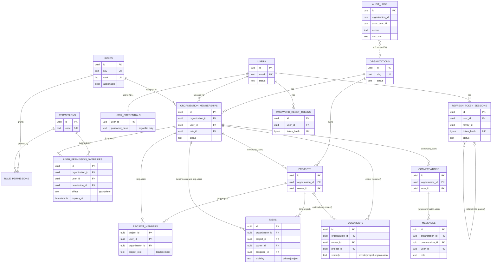

# SecureAI Workspace — Phase 1: Database Architecture & Multi-Tenant Security

Status: implemented and tested (202 DB-level security tests passing against PostgreSQL 17.6).

| Artifact | Location |
|---|---|
| Cluster bootstrap (roles, DBs) | [docker/postgres/init/00-bootstrap.sh](../docker/postgres/init/00-bootstrap.sh) |
| Schema migration | [migrations/versions/0001_core_schema.py](../migrations/versions/0001_core_schema.py) |
| Security migration (grants, RLS, triggers) | [migrations/versions/0002_security_layer.py](../migrations/versions/0002_security_layer.py) |
| RBAC reference data | [migrations/versions/0003_rbac_reference_data.py](../migrations/versions/0003_rbac_reference_data.py) |
| Fictional dev seed | [app/db/seed_dev.py](../app/db/seed_dev.py) |
| Tests | [tests/db/](../tests/db/) |

---

## 1. Design goals

1. **The database is a security boundary, not just storage.** If an API handler forgets a `WHERE organization_id = ...`, PostgreSQL must still return only rows the caller may see.
2. **Never trust identity from the client.** The DB accepts identity only via `secureai_rls.set_context()`. The backend calls it with values taken from a verified JWT, and the DB re-validates them against live membership state.
3. **Least privilege everywhere.** The API's DB credential can't bypass RLS, owns nothing, can't alter RBAC data, can't read password or token hashes, and can't rewrite audit history.
4. **Defense in depth.** Each control assumes the layer above it might fail (§2).
5. **Secure defaults.** New tasks and documents are `private`. New users are `pending`. Unknown permission codes evaluate to *deny*. A missing context means *zero rows*.

## 2. Layered model

```
 Request ─► FastAPI (Phase 2): verify JWT ─► resolve membership ─► check_permission()
                                   │
                                   ▼  BEGIN; SELECT secureai_rls.set_context(user_id, org_id)
 ┌──────────────────────────── PostgreSQL ─────────────────────────────┐
 │ L1  GRANTs           table + column privileges for secureai_app     │
 │ L2  RLS tenant fence  RESTRICTIVE: organization_id = verified org   │
 │ L3  RLS authz         PERMISSIVE: permission ∧ ownership/membership │
 │ L4  Triggers          column-level rules (who may change visibility)│
 │ L5  Constraints       composite FKs, CHECKs (argon2id-only, etc.)   │
 └─────────────────────────────────────────────────────────────────────┘
```

The mutation tests in §8.3 show each layer catching what another layer misses.

## 3. Database roles and trust boundaries

| Role | Login | BYPASSRLS | Owns | Used by | Why it exists |
|---|---|---|---|---|---|
| `secureai_owner` | no | **no** | schemas, tables | nobody directly | A NOLOGIN owner means no credential can ever "be" the owner. `FORCE ROW LEVEL SECURITY` subjects the owner to RLS too. |
| `secureai_auth_definer` *(Phase 2)* | no | yes | `secureai_auth` functions | pre-auth flows (via SECURITY DEFINER) | Column-scoped read/write on credentials, refresh sessions, reset tokens; audit append. No tenant tables. See phase-2 doc §2. |
| `secureai_rls_definer` | no | yes | RLS helper functions | policies (via SECURITY DEFINER) | Helpers must read memberships/projects without recursive RLS. The role has SELECT on 9 authorization tables and nothing else: no login, no writes. |
| `secureai_migrator` | yes | yes | — (member of owner and definer) | Alembic, seed, ops | Schema changes and trusted maintenance. **Never deployed with the API.** |
| `secureai_app` | yes | **no** | **nothing** | FastAPI | NOINHERIT, member of no role, `search_path = pg_catalog`, `statement_timeout = 15s`. |

Only `00-bootstrap.sh` uses superuser, and only once.

**Trust boundary, stated plainly.** The DB trusts `secureai_app` to call `set_context()` with the user from a verified JWT. It cannot verify the JWT itself, and doing so in SQL would add nothing because the app holds the signing key anyway. What the DB *does* guarantee:
- The user is active.
- The membership is active and the org is active. A tampered org id raises an error; it never silently widens scope.
- The context lasts exactly one transaction.
- The context can't be switched mid-transaction.

If the API process is fully compromised, the attacker can impersonate users through `set_context`. Even then they can't bulk-read password hashes, read refresh or reset token hashes, modify RBAC, bypass org fences within one context, back-date or delete audit events, or run DDL.

> **Phase 2 amendment.** Argon2 verification runs in the app, so `secureai_auth.begin_login()` returns *one* user's hash per call. Every call counts toward the 5-attempt lockout *before* verification and is audited, so extraction is rate-limited per account and leaves a trail. See [phase-2-authentication.md](phase-2-authentication.md) §7.

## 4. Schema

### 4.1 ER diagram



### 4.2 Tables

The brief specified 14 entities. The schema implements all of them and adds 3 tables, each for a specific reason:

| Table | Scope | Notes |
|---|---|---|
| `organizations` | tenant root | `status` (`active`/`suspended`). A suspended org denies all context. |
| `users` | **global** | One identity across many orgs. Profile data only. |
| `user_credentials` *(added)* | global, secret | Split out so the app role has zero privileges on password hashes. CHECK enforces the `$argon2id$v=19$` prefix, so the DB physically refuses plaintext or weaker hashes. |
| `roles` | global reference | `rank` orders privilege; `assignable=false` for Super Admin. |
| `permissions` | global reference | `code` = `resource.action`, with generated `resource` and `action` columns. |
| `role_permissions` | global reference | Read-only for the app. |
| `organization_memberships` | tenant | `UNIQUE(organization_id, user_id)` is the **target of every composite FK**. |
| `user_permission_overrides` | tenant | Explicit grant/deny per (org, user, permission), optional expiry, mandatory reason. |
| `projects` | tenant | `UNIQUE(organization_id, id)` is the FK target for children. |
| `project_members` *(added)* | tenant | Implements "projects can have multiple authorized members". `lead`/`member`. |
| `tasks` | tenant | owner + optional assignee; `visibility` defaults to `private`. |
| `documents` | tenant | `storage_key` is server-generated, with a path-traversal-safe CHECK. Visibility is private/project/organization. |
| `conversations` | tenant + personal | `UNIQUE(organization_id, id, user_id)` is the FK target for messages. |
| `messages` | tenant + personal | Owner denormalized and pinned by a composite FK. Immutable. |
| `refresh_token_sessions` | per user | Stores `token_hash` only (HMAC-SHA256). `family_id`/`parent_id` support reuse detection. |
| `password_reset_tokens` *(added)* | per user | Hash only; CHECK enforces a TTL of at most 1 hour. No app grants: Phase 2 accesses it only through definer functions. |
| `audit_logs` | tenant (nullable for pre-auth events) | No FKs (records outlive their subjects). Append-only via trigger. |

### 4.3 Relationships

| Requirement | How it is modelled |
|---|---|
| One org has many users; one user belongs to many orgs | M:N through `organization_memberships` |
| Each membership has an org-specific role | `organization_memberships.role_id`. Meera is Viewer in A and Employee in B. |
| Role → many permissions | `role_permissions` (M:N) |
| User-specific grants/denials | `user_permission_overrides`, keyed by **(org, user)**, so an override in Org B never affects Org A |
| Project belongs to org; has many members | `projects.organization_id`; `project_members` (M:N) |
| Task belongs to project, has owner | `tasks.(organization_id, project_id)` → `projects`; `tasks.(organization_id, owner_id)` → `memberships` |
| Document belongs to org, has owner | `documents.(organization_id, owner_id)` → `memberships`; optional project |
| Conversation belongs to user + org | `conversations.(organization_id, user_id)` → `memberships` |
| Message belongs to conversation | `messages.(organization_id, conversation_id, user_id)` → `conversations.(organization_id, id, user_id)` |

**Why composite foreign keys matter.** A plain `tasks.project_id → projects.id` FK lets a row in Org A point at a project in Org B. Composite FKs `(organization_id, project_id) → projects(organization_id, id)` make that combination impossible at the integrity layer. They hold even for a BYPASSRLS role (`test_composite_fk_blocks_cross_tenant_reference_even_when_rls_is_bypassed`). Referencing `(organization_id, user_id)` on **memberships** rather than `users.id` also guarantees every owner and assignee is a member of that org.

**Why RESTRICT and not CASCADE on `tasks → projects`.** FK cascades run without RLS. With CASCADE, a project owner deleting a project would silently delete other people's private tasks, which they could never have deleted directly.

**UUIDs.** `gen_random_uuid()` (v4) is non-enumerable. The app role has **no INSERT privilege on `id` columns**, so clients can't choose IDs. That closes a subtle oracle: inserting a chosen ID and getting a PK violation would reveal that the ID exists in another tenant.

## 5. Permission model

### 5.1 Permissions (22)

The 20 permissions in the brief, plus `permission.manage` (governs overrides) and `document.update` (metadata edits, kept separate from upload).

### 5.2 Permission matrix

| Permission | Super Admin | Org Admin | Manager | Employee | Viewer |
|---|:-:|:-:|:-:|:-:|:-:|
| organization.read | ✅ | ✅ | ✅ | ✅ | ✅ |
| organization.update | ✅ | ✅ | | | |
| user.read | ✅ | ✅ | ✅ | ✅ | |
| user.create | ✅ | ✅ | | | |
| user.update | ✅ | ✅ | | | |
| user.delete | ✅ | ✅ | | | |
| permission.manage | ✅ | ✅ | | | |
| project.create | ✅ | ✅ | ✅ | | |
| project.read | ✅ | ✅ | ✅ | ✅ | ✅ |
| project.read_all | ✅ | ✅ | | | |
| project.update | ✅ | ✅ | ✅ | | |
| project.delete | ✅ | ✅ | ✅ | | |
| task.create | ✅ | ✅ | ✅ | ✅ | |
| task.read | ✅ | ✅ | ✅ | ✅ | ✅ |
| task.update | ✅ | ✅ | ✅ | ✅ | |
| task.delete | ✅ | ✅ | ✅ | | |
| document.read | ✅ | ✅ | ✅ | ✅ | ✅ |
| document.upload | ✅ | ✅ | ✅ | ✅ | |
| document.update | ✅ | ✅ | ✅ | ✅ | |
| document.delete | ✅ | ✅ | ✅ | ✅ | |
| chatbot.use | ✅ | ✅ | ✅ | ✅ | |
| audit.read | ✅ | ✅ | | | |
| **rank / API-assignable** | 100 / **no** | 80 / yes | 60 / yes | 40 / yes | 20 / yes |

**Super Admin does not bypass tenant isolation.** It is a platform-operator role, assignable only by ops tooling. It acts only inside orgs where it holds a membership, so its cross-tenant access is explicit and visible in the audit log. A "god mode" that skips RLS is the most common way multi-tenant isolation fails.

### 5.3 Effective-permission algorithm and precedence

`secureai_rls.has_permission_id()` (and Phase 2's `check_permission()`, which mirrors it):

```
1. No active membership (or user/org not active) in the CURRENT org → DENY
2. Explicit, unexpired DENY override for (org, user, permission)   → DENY   ← deny always wins
3. Explicit, unexpired GRANT override                              → ALLOW
4. Role has the permission via role_permissions                    → ALLOW
5. Otherwise                                                       → DENY   ← default deny
```

- **Deny beats grant**, including a grant that comes from the role. This makes denies a reliable kill switch during incident response and access reviews.
- At most one override per (org, user, permission) (`UNIQUE`), so a grant and a deny can never conflict on the same row.
- Overrides are **org-scoped**. A deny on Meera in Org B has no effect on her in Org A (`test_override_in_other_org_has_no_effect`).
- **Unknown codes are denied.** `has_permission('task.reed')` returns false.
- **Expired overrides are ignored** (`expires_at`). Use this for time-boxed grants.
- Evaluated **live on every transaction**, with no caching, so a revocation applies to the very next request (brief item 14).

### 5.4 Permission is necessary, not sufficient (RBAC + resource-level)

A permission answers *"may you perform this kind of action?"*. Row policies then answer *"on this row?"*:

| Resource | Read | Write |
|---|---|---|
| Task `private` | owner, assignee | owner/assignee (`task.update`) |
| Task `project` | + project participants, + `project.read_all` | + project managers (owner/lead) |
| Task delete | — | `task.delete` ∧ (owner ∨ project manager) |
| Document `private` | owner | owner |
| Document `project` | + project participants, + `project.read_all` | owner |
| Document `organization` | any member with `document.read` | owner |
| Conversation / message | owner only (**admins excluded**) | owner; messages immutable |
| Project | owner, members, `project.read_all` | managers update; owner deletes |

These rules express the brief's examples:
- Priya (Employee) reads her private tasks; Rahul can't.
- Rahul (Manager, Apollo lead) reads the Apollo team's project tasks but not Priya's private ones, and nothing in Helios.
- Akshay (Org Admin) manages users. `project.read_all` lets him *see* every project task but not *edit* them, and not see anyone's private tasks.

The `_all` suffix is the scope-widening pattern. Only `project.read_all` exists today; add more (e.g. `task.update_all`) only when there is a real need.

### 5.5 Anti-escalation rules (enforced in RLS, not just in code)

| Rule | Where |
|---|---|
| You can never modify **your own** membership or overrides | `user_id <> me` in memberships/overrides policies |
| You may only manage members whose role rank ≤ yours, and only assign roles with rank ≤ yours that are `assignable` | `role_rank()`, `can_assign_role()` |
| Super Admin can't be granted through the app at all | `roles.assignable = false` |
| Marking a member `removed` needs `user.delete`, not just `user.update` | memberships WITH CHECK |
| **You can't delegate what you don't hold**: a GRANT override requires the grantor to effectively hold that permission | overrides WITH CHECK `has_permission_id(permission_id)` |
| Project leads can't promote themselves; only the owner may add themselves | project_members policies |
| `organization_id`, `owner_id`, `project_id`, `user_id` are not updatable | column-level GRANTs |
| RBAC catalogue is read-only to the app | GRANT SELECT only |

## 6. Row-Level Security

### 6.1 Context mechanism

```sql
BEGIN;
SELECT secureai_rls.set_context(:user_id_from_verified_jwt, :org_id_from_token_claim);
-- ... all queries for this request ...
COMMIT;   -- context is gone
```

`set_context()` (SECURITY DEFINER):
1. Rejects a NULL user.
2. Rejects a second call in the same transaction (no identity switching).
3. Requires `users.status = 'active'`.
4. If an org is given, requires an active membership in an active org.
5. Writes `secureai.user_id`, `secureai.org_id` and `secureai.ctx_tx` with `set_config(..., is_local => true)`, which is the same as `SET LOCAL`.

`current_user_id()` and `current_org_id()` return a value **only if** `secureai.ctx_tx` matches the current transaction's stamp (`transaction_timestamp` + backend pid). This defends against the most common pool-leak bug: someone writes `SET secureai.user_id = ...` (session-level) or uses a pooler in session mode. A value that outlives its transaction carries a stale stamp and is ignored (`test_session_level_set_is_ignored`, `test_stale_stamp_from_previous_transaction_is_ignored`).

They also use `NULLIF(current_setting(name, true), '')`. After a `SET LOCAL` ends, a custom GUC reverts to `''`, not NULL, and `''::uuid` would *raise* rather than fail closed.

Missing context ⇒ helpers return NULL ⇒ `organization_id = NULL` is NULL ⇒ every row is filtered out and every INSERT fails its WITH CHECK (brief item 11).

### 6.2 Helper functions

All are owned by `secureai_rls_definer` with `SET search_path = pg_catalog, pg_temp`. They use only schema-qualified names, have EXECUTE revoked from PUBLIC, and answer questions about **the current context only** (for example, `member_rank()` refuses other orgs, so there is no cross-tenant oracle).

| Function | Purpose |
|---|---|
| `set_context(user, org)` | establish validated, transaction-scoped identity |
| `current_user_id()`, `current_org_id()` | read context (NULL ⇒ deny) |
| `has_permission(code)`, `has_permission_id(id)` | §5.3 algorithm |
| `current_role_rank()`, `member_rank(org,user)`, `role_rank(role)`, `can_assign_role(role)` | anti-escalation |
| `my_org_ids()`, `my_project_ids()`, `my_managed_project_ids()`, `my_owned_project_ids()` | membership sets (always return `'{}'`, never NULL) |
| `is_project_participant(project, user)` | assignee validation |

**Why SECURITY DEFINER with a BYPASSRLS owner:** a policy on `projects` that reads `project_members`, whose policy reads `projects`, recurses infinitely. Definer helpers break the cycle. The risk is contained: the owner can't log in, has SELECT on 9 tables only, and every helper pins `search_path`. Without the pin, an attacker who can create objects could shadow `pg_catalog` functions and hijack a privileged function.

**Performance pattern:** policies call `(SELECT secureai_rls.has_permission('x'))` rather than `secureai_rls.has_permission('x')`. An uncorrelated sub-select becomes an InitPlan that is evaluated **once per statement**, not once per row. Array helpers are written as `col = ANY ((SELECT f())::uuid[])`. The cast is required; without it PostgreSQL treats the parentheses as `ANY(subquery)` and fails with `uuid = uuid[]`.

### 6.3 Policy catalogue

All policies are `TO secureai_app`. With `FORCE ROW LEVEL SECURITY`, every other non-BYPASSRLS role, including the owner, matches no policy and sees nothing (`test_owner_role_is_subject_to_rls`).

#### Tenant fence (all 8 tenant tables): `tenant_fence` — RESTRICTIVE, FOR ALL
```sql
USING (organization_id = current_org_id())  WITH CHECK (organization_id = current_org_id())
```
**Why:** permissive policies are OR-ed together; restrictive policies are AND-ed onto them. The fence guarantees tenant isolation **even if a future permissive policy is wrong**. §8.3 shows this. Without the fence on `tasks`, Akshay's `project.read_all` (granted in Org A) exposed Org B's project tasks, and Meera saw her Org B task while in Org A context, because `owner_id = me` doesn't mention an org. Authorization policies answer *who*; the fence answers *which tenant*. Keep them separate.

#### organizations
- `organizations_select_member`: `id = ANY(my_org_ids())`. You see only orgs you actively belong to (needed for the org switcher before an org is chosen).
- `organizations_update_admin`: current org ∧ `organization.update`. Only `name` is updatable (column grant); `status` is ops-only.
- No INSERT/DELETE policy: org creation is a Phase 2 definer flow.

#### users (global, so no org fence)
- `users_select_self`: `id = me`.
- `users_select_org_directory`: `user.read` ∧ EXISTS membership in the *current* org. The sub-select on memberships is itself RLS-filtered.
- `users_update_self`: only `display_name` is updatable (column grant). `email` and `status` aren't, so a user can't re-activate a disabled account or take over an email.

#### organization_memberships
- `memberships_select`: own row ∨ `user.read`.
- `memberships_insert`: `user.create` ∧ not self ∧ `invited_by = me` ∧ status `invited` ∧ `can_assign_role(role_id)`. (Phase 1 also allowed `active`; migration 0006 removed that, so only the invitee activates a membership. See phase-3 doc §8.3.)
- `memberships_update`: USING (old row) requires `user.update`, not self, and target rank ≤ mine. WITH CHECK (new row) requires the new role to be assignable by me, and `removed` requires `user.delete`.
- No DELETE: members are `removed`, preserving FK history.

**Attack blocked:** Priya runs `UPDATE organization_memberships SET role_id = <org_admin> WHERE user_id = me`. It affects 0 rows (brief item 6).

#### user_permission_overrides
- select: own overrides ∨ `permission.manage`.
- insert/update/delete: `permission.manage` ∧ not self ∧ target rank ≤ mine. Grants also require that I hold the permission (`created_by = me` on insert).

#### projects / project_members
- `projects_select`: `project.read` ∧ (owner ∨ member ∨ `project.read_all`).
- `projects_insert`: `project.create` ∧ `owner_id = me` (no creating projects "as" someone else).
- `projects_update`: `project.update` ∧ I manage it (owner or lead).
- `projects_delete`: `project.delete` ∧ owner. RESTRICT FKs block deleting non-empty projects.
- `project_members_*`: managers manage membership. No self-promotion. Anyone may leave.

#### tasks
- `tasks_select`: `task.read` ∧ (owner ∨ assignee ∨ (project-visible ∧ (participant ∨ `project.read_all`))).
- `tasks_insert`: `task.create` ∧ `owner_id = me` ∧ I participate in the project ∧ the assignee (if any) participates.
- `tasks_update`: `task.update` ∧ (owner ∨ assignee ∨ manager of a project-visible task); WITH CHECK repeats this plus assignee validity.
- `tasks_delete`: `task.delete` ∧ (owner ∨ manager of a project-visible task).
- Trigger `tasks_enforce_update_rules`: **only the owner** may change `visibility`; only the owner or a project manager may change `assignee_id`. RLS can say *whether* you can update a row, not *which columns*. Without the trigger, an assignee could flip the owner's private task to `project` and publish it.

#### documents
- select: `document.read` ∧ (owner ∨ `organization` ∨ (`project` ∧ (participant ∨ `project.read_all`))).
- insert: `document.upload` ∧ `owner_id = me` ∧ (no project ∨ my project).
- update: `document.update` ∧ owner; WITH CHECK stops moving a document into a project you aren't in.
- delete: `document.delete` ∧ owner.

#### conversations / messages
- `conversations_owner` (FOR ALL): `user_id = me` ∧ `chatbot.use`.
- `messages_select` and `messages_insert`: `user_id = me` ∧ `chatbot.use`. The composite FK `(org, conversation_id, user_id)` means `user_id = me` can only point at *my* conversation. No UPDATE/DELETE grants exist, so history is immutable. Admins can't read AI chats: these often contain sensitive prompts, so access for investigations should be a separate, audited break-glass process.

#### refresh_token_sessions
- select/insert/update: `user_id = me` (lets a user list and revoke their own devices). `token_hash` is **write-only** to the app (column-level SELECT excludes it). Phase 2's rotation will be a definer function with `SELECT ... FOR UPDATE` for race-safe reuse detection.

#### user_credentials, password_reset_tokens
- RLS enabled + forced, **no policies, no grants**: default deny. Phase 2 adds narrow definer functions (`verify_login`, `consume_reset_token`, …).

#### audit_logs
- select: current org ∧ `audit.read`.
- insert: org is NULL (pre-auth events) or the current org, ∧ actor is NULL or me. No forging other actors and no writing into another tenant's trail.
- The app can't set `id` or `occurred_at`, so events can't be back-dated.
- Trigger `audit_logs_append_only` blocks UPDATE/DELETE/TRUNCATE for **everyone**, including BYPASSRLS ops roles. A retention purge must explicitly disable the trigger as the owner, which is a DDL event logged by `log_statement=ddl`.

## 7. Attacker playbook

| # | Attempt | What stops it | Test |
|---|---|---|---|
| 1 | Forget `WHERE org_id` in a handler / SQL injection `SELECT * FROM tasks` | tenant fence + authz policies | `test_unfiltered_select_returns_exactly_authorized_tasks` |
| 2 | Send `organization_id` of Org B in a request body | fence WITH CHECK | `test_cannot_insert_task_into_other_org` |
| 3 | Tamper org claim/header to an org you aren't in | `set_context` re-validates membership | `test_set_context_rejects_org_user_is_not_member_of` |
| 4 | `UPDATE ... SET organization_id = B` to "move" a row | column privileges | `test_cannot_move_row_to_another_org_via_update` |
| 5 | Reference Org B's project from an Org A task | RLS + composite FK | `test_cannot_reference_other_org_project_from_own_org`, `test_composite_fk_blocks_…` |
| 6 | Guess the UUID of another user's private task | RLS; random UUIDs | `test_private_task_invisible_to_others` |
| 7 | Self-promote to admin | `user_id <> me`, rank checks | `test_employee_cannot_promote_self` |
| 8 | Admin grants Super Admin | `assignable = false` | `test_admin_cannot_grant_non_assignable_super_admin` |
| 9 | Grant yourself `audit.read` via override | not-self, `permission.manage` | `test_user_cannot_grant_self_permission` |
| 10 | Assignee publishes owner's private task | trigger | `test_assignee_cannot_change_visibility` |
| 11 | Append to someone else's AI conversation | composite FK / RLS | `test_cannot_append_to_someone_elses_conversation_*` |
| 12 | Rewrite chat history | no UPDATE grant | `test_messages_are_immutable` |
| 13 | Read password/refresh/reset hashes via SQLi | no grants / column grants | `test_app_cannot_read_secrets` |
| 14 | Grant Employee role every permission via SQLi | RBAC tables read-only | `test_app_cannot_modify_rbac_catalogue_even_as_admin` |
| 15 | Delete or back-date audit events | no grant, append-only trigger, no `occurred_at` grant | `test_audit_logs.py` |
| 16 | Session-level `SET secureai.user_id` leaking via pool | transaction stamp | `test_session_level_set_is_ignored` |
| 17 | Switch identity mid-transaction (confused deputy) | `set_context` refuses a second call | `test_context_cannot_be_switched_within_a_transaction` |
| 18 | Disabled user / suspended membership / suspended org keeps working | checked on every `set_context` | `test_set_context_rejects_*` |
| 19 | Store plaintext password by mistake | CHECK `$argon2id$` | `test_db_rejects_non_argon2id_password_hash` |
| 20 | Path traversal in storage key | CHECK constraint | `test_document_path_traversal_storage_key_rejected` |

## 8. Testing

### 8.1 Running

```bash
cp .env.example .env            # then replace every secret (or generate: openssl rand -hex 24)
docker compose up -d --wait
uv sync
uv run alembic upgrade head     # dev database
uv run python -m app.db.seed_dev
uv run pytest -v                # rebuilds the separate secureai_test DB from scratch
```

### 8.2 Coverage against the brief (DB layer)

| Brief item | Phase 1 (DB) tests | Phase 2 adds |
|---|---|---|
| 1 Unauthenticated access | `test_no_context_*` | HTTP 401 tests |
| 2 Expired JWT, 3 bad signature | — | JWT tests |
| 4 Private tasks | `test_private_task_invisible_to_others` (7 cases) | API tests |
| 5 Org isolation | `test_rls_tenant_isolation.py` | API tests |
| 6 Self-promotion | `test_employee_cannot_promote_self` + related membership tests | API tests |
| 7 Org id tampering | `test_cannot_insert_task_into_other_org`, `test_cannot_move_row_*`, `test_set_context_rejects_org_*` | body/query param tests |
| 8 Unauthorized documents | `test_rls_documents_conversations.py` | — |
| 9 Unauthorized UPDATE/DELETE | `test_task_update_authorization`, `test_task_delete_authorization`, `test_document_write_authorization` | — |
| 10 Refresh reuse | (schema only) | rotation/reuse tests |
| 11 Missing context | `test_no_context_*` (14 cases) | — |
| 12 Omitted app filters | every unfiltered SELECT test | — |
| 13 Pool leakage | `test_sqlalchemy_pool_reuse_does_not_leak_identity` + 5 related | middleware tests |
| 14 Revocation | `test_permission_revocation_applies_to_next_transaction`, `test_role_downgrade_*` | API tests |

**Expected result:** `202 passed`. Negative tests expect either `InsufficientPrivilege` (SQLSTATE 42501, matched on message: `row-level security`, `permission denied`, or our own `secureai:` messages), `ForeignKeyViolation`, `CheckViolation`, or **0 affected rows**. RLS `USING` failures on UPDATE/DELETE are silent (0 rows); only `WITH CHECK` failures raise. Phase 2 must therefore turn "0 rows affected" into HTTP 404, which also avoids revealing that the row exists.

### 8.3 Mutation checks (proving the tests can fail)

| Mutation | Result |
|---|---|
| `tasks_select` replaced with `USING (true)` | 18 tests fail (all private-task and visibility tests). **Cross-org tests still pass**: the restrictive fence held. |
| `tenant_fence` removed from `tasks` | 6 tests fail, including a **real cross-tenant leak**: Org A's admin saw Org B project tasks via `project.read_all`, and Meera saw her Org B task in Org A context. |

## 9. Common mistakes (and what this design does instead)

1. **Running the app as the table owner or a superuser.** The owner bypasses RLS unless `FORCE` is set, and superusers always bypass it. → NOLOGIN owner, FORCE on every table, and a test asserting the app role owns nothing.
2. **`SET` instead of `SET LOCAL`** with a connection pool leaks identity to the next request. → `set_config(..., true)` inside `set_context()` + transaction stamp.
3. **Trusting `org_id` from a header/body/path.** → org comes from the verified token and is re-validated by the DB on every transaction.
4. **Only permissive policies.** One bad policy opens everything. → restrictive tenant fence.
5. **`current_setting('x')::uuid`**: errors when the setting is missing and raises on `''`. → `NULLIF(current_setting('x', true), '')`.
6. **NULL ≠ false.** `NOT (x = ANY(NULL))` is NULL and `IF NULL` doesn't fire, so the check fails open. → helpers return `'{}'`; the trigger uses `IS NOT TRUE`.
7. **SECURITY DEFINER without `SET search_path`**, which allows search-path hijacking. → pinned on every function, plus a test.
8. **Functions executable by PUBLIC (the PostgreSQL default).** → revoked globally via `ALTER DEFAULT PRIVILEGES` (per-schema defaults *can't* revoke it) and tested.
9. **Recursive policies** (A's policy reads B, B's reads A). → definer helpers.
10. **Per-row function calls in policies.** → `(SELECT f())` InitPlans.
11. **Role-name checks (`if role == "admin"`).** → only `has_permission()`; role names never appear in policies.
12. **Granting the app UPDATE on whole tables**, which lets it change `organization_id`/`owner_id`. → column-level grants.
13. **Cascading deletes across ownership boundaries** (cascades bypass RLS). → RESTRICT.
14. **Plain FKs in multi-tenant schemas.** → composite `(organization_id, …)` FKs.
15. **A "super admin bypasses RLS" shortcut.** → Super Admin works through memberships like everyone else.
16. **Storing refresh/reset tokens in plaintext**, or letting the app read their hashes. → hash only, write-only column, separate tables.
17. **Client-chosen primary keys.** → no INSERT grant on `id`.
18. **PostgreSQL regex limits:** repetition counts above 255 (`{8,512}`) are rejected *at insert time*, not at DDL time. We hit this during development; it is now a length CHECK plus a simple character class.

## 10. Residual risks and Phase 2 hand-off

- **Compromised API process** can impersonate users through `set_context` (§3). Mitigations: network isolation, short-lived DB credentials, monitoring of `set_context` failure rates.
- **Pre-auth paths** (login, registration, refresh rotation, password reset) need narrow SECURITY DEFINER functions in a new `secureai_auth` schema with their own definer role. These are Phase 2.
- **`refresh_token_sessions` rotation** must be atomic (`SELECT … FOR UPDATE`) to make reuse detection race-safe. This is Phase 2.
- **Audit integrity against a DB superuser** isn't covered. Ship logs to an external append-only sink, or add hash chaining, in a later phase.
- ~~**Last-admin lockout:** an admin can demote the only other admin.~~ **Fixed in Phase 2 (migration 0005):** `organization_memberships_last_admin` trigger with a per-org advisory lock; see phase-2 doc §11.
- **Connection poolers:** PgBouncer in *transaction* mode is compatible with this design. *Session* mode is too, thanks to the stamp, but don't use statement mode.
- **Messages with `role='system'`** can be inserted by the app on the user's behalf. The AI-security phase must ensure user input can never be stored or replayed as system/tool content.
